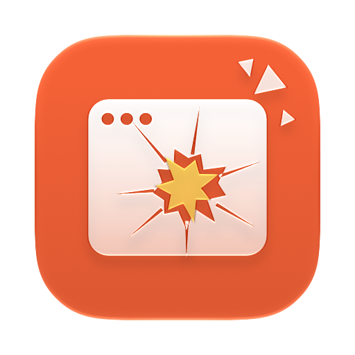
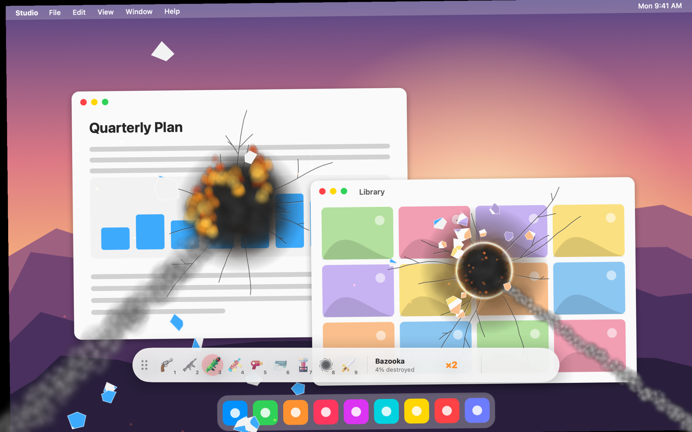

<h2>MacDestroyer</h2>

Wreck your desktop. Nothing real gets hurt.

  

 

MacDestroyer freezes your screen into a picture and hands you a weapon. Blow holes in your windows, set them on fire, slice them in half, then press Esc and everything is exactly as you left it.

## Features

- Nine weapons: pistol, minigun, bazooka, flamethrower, laser, freeze ray, Tesla coil, black hole, and sword
- Mixes: shoot ice to shatter it, torch ice for steam, and chain lightning through fire and holes
- A 3, 2, 1 countdown, combos, ranks, and a trophy room
- Repair everything in one sweep, or save a picture of the wreckage to your Pictures folder
- Sound, screen shake, and debris you can tune
- Lives in the menu bar; start a rampage from anywhere with a shortcut
- Private: the picture of your screen stays in memory, and nothing leaves your Mac

## Download

[Download MacDestroyer](https://github.com/IndieGoodies/MacDestroyer/releases/latest/download/MacDestroyer.dmg), open the DMG, and drag MacDestroyer to Applications. It needs macOS 26 or later, and asks for Screen Recording so it can take the picture it wrecks. Updates arrive on their own.

## Release Notes

See [Releases](https://github.com/IndieGoodies/MacDestroyer/releases).

## Support

Report an issue or request a feature in [GitHub Issues](https://github.com/IndieGoodies/MacDestroyer/issues). More apps at [indiegoodies.com](https://indiegoodies.com/macdestroyer).
